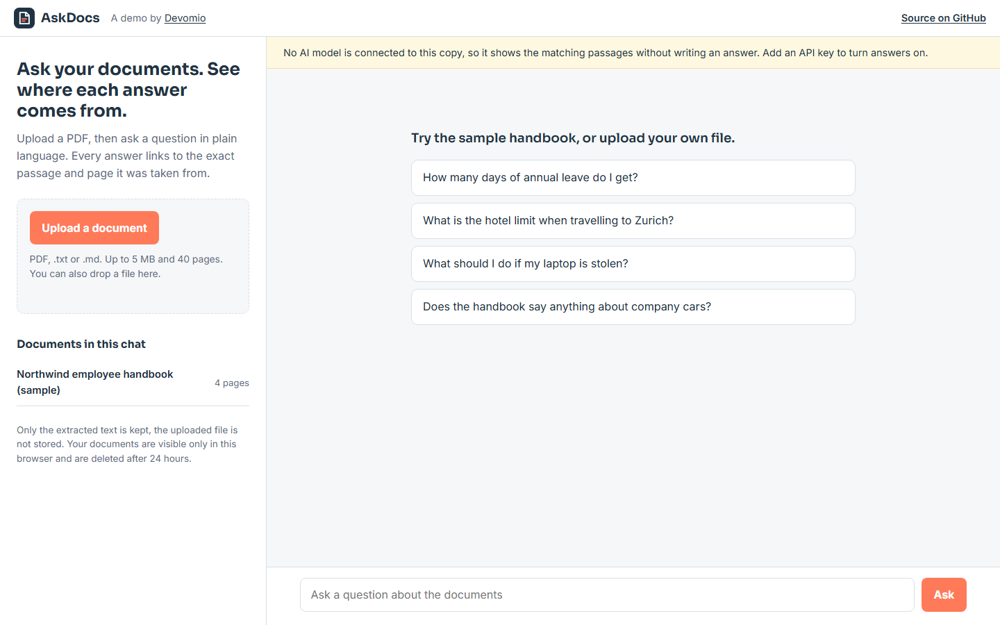

# AskDocs

**Live demo: [askdocs.devomio.com](https://askdocs.devomio.com/)**



Ask questions about your own documents and see exactly where each answer comes from.

Upload a PDF, ask in plain language, and AskDocs answers using only that document. Every statement
carries a numbered marker that opens the exact quoted passage and its page number, so the answer
can be checked in seconds instead of trusted blindly.

Built by [Devomio](https://devomio.com/) as an open example of a retrieval-augmented generation
(RAG) application that is small enough to read in an afternoon and solid enough to put in front of
real users.

## What it does

- **Answers with sources.** Each answer is tied to quoted passages and page numbers. The quotes are
  extracted by the API from the document itself, so they cannot be invented.
- **Says when it does not know.** If the documents do not cover a question, it says so instead of
  guessing.
- **Works before you upload anything.** A sample employee handbook is built in, with starter
  questions.
- **Follow-up questions.** "And for part-time staff?" works, because recent turns are carried along.
- **Private by default.** The uploaded file is never stored, only its extracted text. Documents are
  visible only to the browser session that uploaded them and are deleted after 24 hours.
- **Safe to expose publicly.** Per-visitor and site-wide daily limits, file size and page limits,
  CSRF protection, and no raw IP addresses stored.

## How it works

```
PDF / text  ->  extract text per page  ->  split into passages (never across a page)
question    ->  rank passages (BM25)   ->  top passages sent to Claude as cited documents
Claude      ->  answer + exact quotes  ->  shown with page numbers
```

1. **Extract** (`rag/services/extract.py`): `pypdf` reads the text of each page in memory.
2. **Chunk** (`rag/services/chunking.py`): pages are split into passages of roughly 900 characters
   on paragraph and sentence boundaries. A passage never crosses a page, so every citation can name
   one page.
3. **Retrieve** (`rag/services/retrieval.py`): passages are ranked against the question with BM25,
   written in plain Python. A visitor's workspace holds a few hundred passages at most, so this is
   fast and needs no vector database or embedding service.
4. **Answer** (`rag/services/answer.py`): the best passages are sent to Claude as separate documents
   with [citations](https://platform.claude.com/docs/en/build-with-claude/citations) enabled. The
   reply comes back as text plus the exact quotes that support it.

Retrieval sits behind a single function, `search(question, chunks, top_k)`. Replacing BM25 with
embeddings and a vector store for large document sets only changes that file.

## Run it locally

Requires Python 3.12 or newer.

```bash
git clone https://github.com/aidevmonir-dev/askdocs.git
cd askdocs
python -m venv .venv
.venv/bin/pip install -r requirements.txt        # Windows: .venv\Scripts\pip
cp .env.example .env                             # set DEBUG=1 and your ANTHROPIC_API_KEY
.venv/bin/python manage.py migrate
.venv/bin/python manage.py runserver
```

Open http://127.0.0.1:8000/.

Without an `ANTHROPIC_API_KEY` the app still runs: it shows the passages that match the question
but does not write an answer. That mode is useful for checking retrieval on your own documents.

### With Docker

```bash
cp .env.example .env      # set SECRET_KEY, ANTHROPIC_API_KEY, ALLOWED_HOSTS=localhost
docker compose up --build
```

Open http://localhost:8000/.

## Configuration

All settings come from environment variables or a `.env` file. See [.env.example](.env.example).

| Variable | Default | Purpose |
|---|---|---|
| `ANTHROPIC_API_KEY` | none | Claude API key. Empty means passages only, no written answers. |
| `ANTHROPIC_MODEL` | `claude-opus-5-5` | Any current Claude model. `claude-haiku-5-5` costs far less. |
| `ANTHROPIC_EFFORT` | `low` | How much reasoning the model spends per answer. |
| `QUESTIONS_PER_IP_PER_DAY` | `25` | Daily question limit per visitor. |
| `QUESTIONS_PER_DAY_TOTAL` | `400` | Daily question limit for the whole site. |
| `MAX_PAGES` / `MAX_FILE_BYTES` | `40` / 5 MB | Upload limits. |
| `RETENTION_HOURS` | `24` | How long visitor documents are kept. |

## Tests

```bash
DEBUG=1 python manage.py test
```

The tests cover chunking, PDF handling, retrieval on the sample handbook, citation parsing, session
privacy, upload and rate limits, and data expiry. The Claude API is replaced by a fake client, so
they run offline and cost nothing.

## Data handling

- Uploaded files are parsed in memory and discarded. Only the extracted text is saved.
- Documents belong to one browser session. Other visitors cannot list, query or delete them.
- Visitor data is deleted after `RETENTION_HOURS`. Run `python manage.py purge_expired` from cron to
  enforce this on a quiet site; it also runs whenever someone uploads.
- Rate-limit counters store a hash of the IP address, not the address.
- The passages relevant to a question are sent to the Claude API to write the answer. To keep data
  entirely on your own servers, replace the client in `rag/services/answer.py` with a local model.

## Limits of this demo

- Scanned PDFs without a text layer are rejected. They need OCR first.
- Keyword retrieval matches words, not meaning. A question phrased with none of the document's
  words can miss. Embeddings fix that at the cost of more infrastructure.
- Tables and multi-column layouts are read as plain text and can lose their structure.

## Need this for your business?

AskDocs is a starting point. Devomio builds production versions: your documents and knowledge
base, your branding, user accounts, larger document sets, and integration with the tools you
already use. See [devomio.com](https://devomio.com/) or write to hello@devomio.com.

## Licence

MIT. See [LICENSE](LICENSE).
